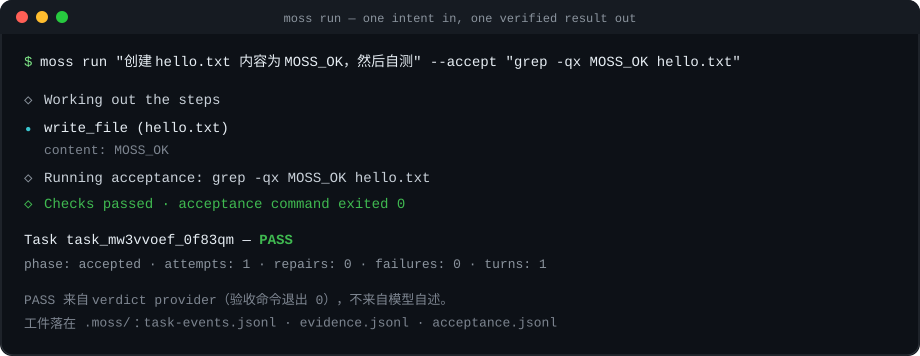

<div align="center">

# Moss

**一句话意图 → 一个任务 → 一次被验证的完成。**
把"模型说完成了"变成"验收命令说完成了"——代码如此，机器人真机也如此。

[](https://www.npmjs.com/package/@rdk-moss/agent)
[](LICENSE)
[](https://nodejs.org)
[](#支持矩阵)

**中文** · [English](README.en.md)

</div>

```bash
npm install -g @rdk-moss/agent@latest
moss setup
moss goal "创建 hello.txt 内容为 MOSS_OK，然后自测" --accept "grep -qx MOSS_OK hello.txt"
```



一次真实运行（deepseek-flash，本机；本次实测 10.7 秒）：

```text
◇ Working out the steps
◇ Checks passed
Task task_mw3vvoef_0f83qm — PASS
phase: accepted · attempts: 1 · repairs: 0 · failures: 0 · turns: 1
```

`PASS` 不来自模型的自述，而来自验收命令退出 0。这是 Moss 与其他 agent 的根本区别：
**没有证据背书就不算完成。**

- **可机检的完成**：目标被编译成带验收命令的任务状态机，只有 verdict provider 能判 PASS
- **真机也在回路里**：SSH 直连 RDK / Linux，部署→运行→测量→验收都留证据
- **四种交互面同一套语义**：TUI · REPL · headless（脚本/CI）· SDK（semver 保护）

## 为什么是 Moss

普通 coding agent 的"完成"是模型说自己完成了。Moss 把这条判定链做成可审计的机器流程：

```text
task_define（目标 + 可机检验收标准）
  → 执行（读写文件 / 跑测试 / SSH 到板子）
  → record_evidence（Expected / Observed / Result 结构化证据）
  → task_acceptance（按 metric 匹配最新证据裁决）
```

- **完成只能来自 verdict provider**（验收命令 > 任务契约）——模型散文永远不是事件
- 缺证据 = 未完成；`latest-wins` 支持修完再测；修复次数用尽时任务诚实 FAIL 并给出续跑命令
- 每个任务走同一个事件驱动状态机：`planning → executing → verifying → diagnosing → repairing → accepted | failed | blocked`
- 所有产物落在工作区 `.moss/`：可复现、可审计、可被 CI 读取

同一个内核还让"完成"可以发生在**真机**上：SSH 直连 RDK / Linux 板卡，部署、运行、测量、
验收都在回路里——这是纯 IDE 型 agent 做不到的。

## 上手

**1. 装（一行，Node ≥ 22.16）：**

```bash
npm install -g @rdk-moss/agent@latest && moss setup
```

环境前提、升级/卸载、代理、Windows 与自定义网关见 [安装与运行环境](docs/install.md)。

**2. 首次进项目：**

```bash
moss init        # 检测 test/build/lint 入口，写一份最小 AGENTS.md，并打印下一条验证式运行命令
```

**3. 选一个交互面：**

| 你在做什么             | 用这个                                        |
| ---------------------- | --------------------------------------------- |
| 想边聊边改、看流式输出 | `moss`（全屏 TUI；无 TTY 自动回退 REPL）      |
| 只想问一次             | `moss "总结这个仓库的架构"`                   |
| 要一个**被验证的结果** | `moss goal "<意图>" --accept "<验收命令>"`    |
| 交给脚本 / CI          | `moss -p "..."` · `moss goal ... --json`      |
| 反复跑到外部命令通过   | `moss loop --until "npm test" "修到测试全绿"` |
| 多步依赖（JSON 计划）  | `moss goal --workflow plan.json`              |

**chat 与 goal 的区别。** 裸自然语言（`moss` / `moss "…"` / `moss -p "…"`）就是普通对话：
模型停下即结束，不写运行账本。要让"你指定的命令通过才算完"，用 `moss goal "<意图>" --accept "<命令>"`
（会话里 `/goal`）：它会计划→执行→验收→修复，写进 `moss runs` 账本、可 resume、有退出码。
`moss run` / `/run` 是同一命令的兼容别名；`moss runs` 是名词——所有被记录的自主执行（task / loop /
workflow / -p chat / superagent）共用一本账，普通交互式聊天不在内。

**4. 第一个"被验证的完成"：**

```bash
moss goal "创建 hello.txt 内容为 MOSS_OK" --accept "grep -qx MOSS_OK hello.txt"
moss runs                              # 所有自主运行（task / loop / -p / workflow）共用一本账：状态 / 原因 / 下一步
moss runs export latest > run.md       # 把这次运行导成 PR/CI 可贴的 Markdown
moss task status --json                # 同一份事实，给脚本/CI 用
```

## 手感

Moss 的交互目标是：**敢让它跑、随时能停、停了能续、错了能退**。
一次 run 的生命周期是可预期的五段：`理解 → 计划 → 执行 → 验收 → 修复`；任何一段都能停，
停下后状态在磁盘上，`resume` 从断点继续而不是重跑。

| 你会做的            | 怎么按 / 怎么输                                                 | 得到什么                                                                           |
| ------------------- | --------------------------------------------------------------- | ---------------------------------------------------------------------------------- |
| 切换权限模式（TUI） | `Shift+Tab`（状态栏常驻 `manual / acceptEdits / plan / full`）  | 从"每步都问"到"默认少问"，随时可回到最严格                                         |
| 停下当前动作        | `Esc`                                                           | 保留已完成的成果；任务运行里 `Ctrl+C` = **暂停而不是丢弃**                         |
| 续跑暂停的任务      | `/goal resume` · `moss goal --resume` · `moss task resume <id>` | 从磁盘状态继续，不重跑已完成的回合；预算可单独指定                                 |
| 撤销这一轮          | `/rewind`                                                       | 文件回到检查点版本，这一轮对话也从上下文撤回（试错成本降到一次按键）               |
| 看改动 / 审 diff    | `/diff` · `/review`                                             | 工作区差异 · 独立评审给出严重/重要/建议三档                                        |
| 管上下文            | `/compact` · `/todos` · `/context`                              | 压缩历史、看计划进度、看窗口用量                                                   |
| 会话内看能力面      | `/capabilities`（REPL / TUI）                                   | 工具 / 技能 / 命令 / 子代理 / hooks / MCP / 设备一屏，`--kind` 只看一节            |
| 会话内看运行账本    | `/runs`（REPL / TUI）                                           | 与 `moss runs` 同一个账本：list / show / export / prune，可按 `--kind` 过滤        |
| 空输入框给下一步    | `Shift+Tab` 前先看占位提示                                      | 有未收尾运行时提示 `Resume with moss task resume <id>`；全新目录提示 `Try "/init"` |
| 长任务结束后        | 直接问                                                          | 下一次聊天自动带上一次运行的 task id、失败原因与续跑命令（只带一次）               |

首屏会显示上一次运行（状态 / 多久前 / 目标）与下一步——失败运行直接给出 `moss task resume <id>`，不用自己翻账本。失败时只给"原因 + 下一步命令"，不要求你回头查文档；`moss doctor` 体检、
`MOSS_STARTUP_TIMING=1` 定位启动慢在哪一阶段。

## 能力

**写代码。** agent loop 管轮次、上下文压缩、nudge 与 loop guard；**51 个内置工具**
覆盖读写/补丁/搜索、进程与后台任务、联网抓取、类型与 lint 诊断、跑测试、子代理、任务契约。
写类工具走审批；会话可保存 / 搜索 / 导出 / fork。一屏总览当前安装能用什么：`moss capabilities`（工具 / 技能 / 命令 / 子代理 / 钩子 / MCP / 设备，只读且不需要模型配置）。**13 个设备工具**把 SSH 真机操作
纳入同一套证据与验收；`moss device fleet` 一条命令做多机只读巡检。

**长任务。** 每次运行在账本里带 token 用量（网关有公开价时还带估算费用，无价就不编造）与「为什么停」的结构化闸门记录（acceptance / verification / review / plan / background + kind）； 每次自主运行结束后，REPL 会按统一账本重新打印一行 `Next`（续跑命令 / `moss runs` / `moss init`），不会把启动时的建议留成过期信息；`/goal` 与 `moss goal` 用同一套任务状态机；`moss loop` 做"跑一轮→用你的命令验收→
失败把输出喂回下一轮"的本地闭环；`moss task status|timeline|list` 是离线读路径（`moss runs --kind task/loop/workflow/chat` 按引擎过滤、`--since 24h` 按时间窗过滤）；只读巡检 `moss artifacts`（契约/证据/部署/验收/设备）连模型配置都不需要；中断的任务
`resume` 时先按当前工作区验收再决定要不要花执行回合。写类子代理可跑在独立 worktree 里，产物以
三方补丁合并回父工作区。

**扩展。** MCP 客户端（stdio + streamable HTTP，工具懒加载）、轻量 skills（渐进披露）、
自定义斜杠命令、文件定义子代理、生命周期 hook、本地能力包（plugins）、
板卡手册由内置 rdk-docs MCP 供给。

**嵌入与自动化。** `-p` 的末行是稳定契约：只有 `accepted` 才 exit 0；"未验证"与"未完成"
可区分（exit 9）。`--output-format json|stream-json` 给 CI 消费；`src/index.ts` 的导出面受
semver 保护，`examples/` 是可运行的集成示例。

## 连真机

```bash
moss device add rdk-01 192.168.1.10 --user root --kind rdk
moss device test rdk-01
moss device fleet info --devices rdk-01,rdk-02 --concurrency 4

# `--accept` 换成你自己的验收脚本：退出码 0 即通过，其余都算没完成
moss goal "相机管线保持 30 FPS 持续 60 秒：部署、运行、记录证据、验收" \
  --accept "python3 bench/check_fps.py --min 30"
```

板端推理依赖（hobot_dnn / TROS）见 [RDK 板端依赖](docs/rdk-board-deps.md)。

## 与最佳产品的关系

|            | Moss                                  | Claude Code       | Cursor     |
| ---------- | ------------------------------------- | ----------------- | ---------- |
| 形态       | 终端 TUI / REPL / headless / SDK      | 终端 + IDE 插件   | IDE 为主   |
| 完成判定   | **验收命令 / 证据裁决**               | 模型判断 + hook   | 模型判断   |
| 长任务     | 任务状态机 + 账本 + 中断续跑          | 会话上下文        | Agent 面板 |
| 真机闭环   | **SSH 原生（部署-测量-验收）**        | 无                | 无         |
| 账号与数据 | 本地优先，无账号无遥测，自有 provider | 需要账号          | 需要账号   |
| 可嵌入     | semver-protected SDK                  | headless 输出契约 | 无         |

Moss 不试图做 IDE：它做的是**可验证执行的运行时**，所以既能当日常 coding agent，
也能当机器人闭环里的裁决器。

## 质量

```bash
npm run check    # prettier + eslint(0 warning) + typecheck
npm run verify   # 交付门：static + build + smoke + examples，目标 ≤60s
npm run bench    # 能力基准（DeepSeek 基准模型）；bench:swe / bench:deepswe / bench:device
```

行为不靠"读代码觉得对"：关键用户可见行为都有可复跑的探针（`scripts/verify/stages/*`，
含 PTY 终端行为与离线任务引擎场景），改坏会在 `npm run verify` 里直接红；
真实模型回归另见 `npm run bench` 与 CI 夜跑矩阵。支持矩阵与验证方式见
[发布策略](docs/release-policy.md)。

## 支持矩阵

| 维度     | 支持                                                     | 验证方式                                       |
| -------- | -------------------------------------------------------- | ---------------------------------------------- |
| Node     | ≥ 22.16.0                                                | fast gate 22.16 + deep 矩阵（三平台、Node 24） |
| 平台     | Linux / macOS / Windows                                  | 同一 verify 命令；Windows 无 PTY smoke         |
| provider | deepseek / qwen / openai / anthropic / openai-compatible | 冒烟 + examples                                |
| 交互面   | TTY：全屏 TUI；非 TTY / `MOSS_NO_TUI=1` / Windows：REPL  | PTY smoke（macOS/Linux）+ TUI bench            |

## 安全与隐私

默认 `full` 是"默认少问"，不是关闭检查：deny 规则与本机硬拦截永远优先，毁灭性设备操作仍要确认，
`--read-only` 是压过一切的只读上限。无账号、无云服务、无遥测；provider 是普通 HTTP 端点；
凭据只从 `.env` 或环境变量读。shell 默认没有操作系统沙箱（可选 seatbelt / bubblewrap），
完整语义见 [安全与隐私](docs/safety.md)。

## 已知边界

- "未验证"与"未完成"同为 exit 9，脚本需要看末行区分
- `workspace-write` 只约束 Moss 自己的文件工具，不约束 shell 子进程
- 子代理与后台任务的编辑不进 `/rewind` 检查点
- 板端推理依赖不自动安装（见 [RDK 板端依赖](docs/rdk-board-deps.md)）
- Windows 无 PTY smoke；版本与 tag 策略见 [发布策略](docs/release-policy.md)

## 文档

- [安装与运行环境](docs/install.md) · [安全与隐私](docs/safety.md) · [命令与配置参考](docs/cli-reference.md)
- [RDK 板端依赖](docs/rdk-board-deps.md) · [能力层（MCP / device / skill）](docs/capability-layer.md)
- [AGENTS.md](AGENTS.md)（工程合同） · [CHANGELOG](CHANGELOG.md) · [发布策略](docs/release-policy.md)
- [与 Claude Code / codex 的命令面基线](docs/cli-parity/) · [设计记录](docs/superpowers/plans/)

## License

MIT（见 [LICENSE](LICENSE)）。
