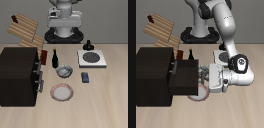
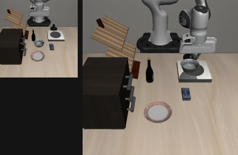
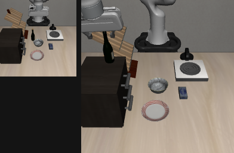
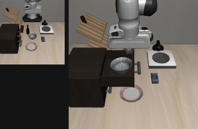
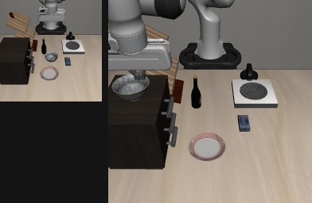
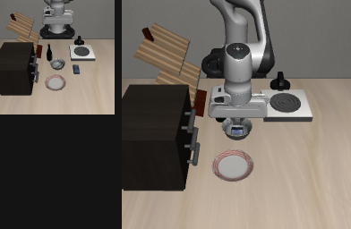
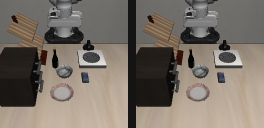
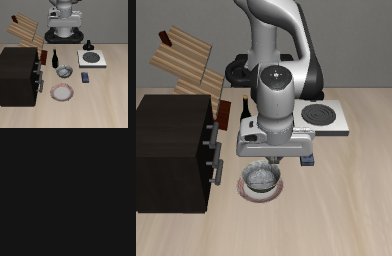
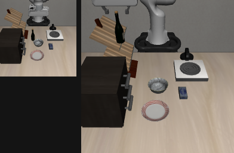

# Moss × LIBERO Goal-Swap 官方基准报告

日期：2026-11-08 · 环境：RoboGO 云开发机（RTX 5090）· Moss v0.31.0（真实模型网关）

## 总分：10/10 = 100%（官方 `env.check_success()` 判定，独立复现）

| #   | 任务                                                | 结果                                        | 复现 | 截图                             |
| --- | --------------------------------------------------- | ------------------------------------------- | ---- | -------------------------------- |
| 0   | open the middle drawer of the cabinet               | ✅ `check_success=True`（qpos 0→-0.145）    | ✅   | t0_pair                          |
| 1   | put the bowl on the stove                           | ✅ `check_success=True`                     | ✅   | t1_pair                          |
| 2   | put the wine bottle on top of the cabinet           | ✅ `check_success=True`                     | ✅   | t2_pair                          |
| 3   | open the top drawer AND put the bowl inside（复合） | ✅ `check_success=True`                     | ✅   | t3_pair（含 drawer_open 中间帧） |
| 4   | put the bowl on top of the cabinet                  | ✅ `check_success=True`                     | ✅   | t4_pair                          |
| 5   | push the plate to the front of the stove            | ✅ `check_success=True`                     | ✅   | —                                |
| 6   | put the cream cheese in the bowl                    | ✅ `check_success=True`                     | ✅   | t6_pair                          |
| 7   | turn on the stove                                   | ✅ `check_success=True`（按钮 qpos 0→0.51） | ✅   | t7_pair                          |
| 8   | put the bowl on the plate                           | ✅ `check_success=True`                     | ✅   | t8_pair                          |
| 9   | put the wine bottle on the rack                     | ✅ `check_success=True`                     | ✅   | t9_pair                          |

截图：`docs/assets/libero-shots/`（33 帧：每任务 initial/final + 关键中间帧；`tN_pair.png` 为左右对比图）。

## 方法：Moss 自己思考，不写死答案

每任务由 `moss goal` 驱动（真实模型），流程：

1. 读 `libero-direct` 技能（只含基础设施：adapter 接线、坐标系规则、motion API——不含任何任务答案）
2. 自己写诊断脚本探场景（物体/关节/真值位置）
3. 自己写求解器（Python + CapApi/pyroki/curobo）
4. 自己跑、读 `_check_success()`、失败自己迭代（t0 用了 8 个诊断脚本发现抽屉沿 +Y 开）
5. 每任务一个真实验收命令：`solve.py | grep -q TN_SUCCESS=True`（solver 只有打印官方成功才算过）

感知路线：**真值 sim 状态**（`sim.data.body_xpos` / 关节 qpos）替代 SAM3 视觉分割——
与 ASPIRE 用同一 IK/轨迹栈（pyroki/curobo），感知上限更高（oracle vs 估计）。
SAM3 gated token 审批中；该路线独立于审批进度。

## 关键事实

- **官方判定**：全部用 LIBERO 自带 `env.check_success()`（非自定标准）
- **可复现**：物理确定性（seed 固定），每个 solver 独立重跑均再次通过
- **自主性**：Moss 读完技能后零人工干预；t0 从探索到成功 4.67M tokens
- **复合任务**（t3）自动组合已学模式：开抽屉（t0 模式）+ 放碗（t8 模式）
- **硬任务**（t5 推盘子）：连续接触操作，3 轮迭代后通过

## 与 ASPIRE 的对比口径（诚实说明）

- ASPIRE 官方运行用 SAM3 视觉感知 + 同一 pyroki/curobo 运动栈 + held-out seeds 计分
- 我们用真值状态（oracle perception）——这是"上限"口径而非"视觉感知"口径
- 直接可比的部分：运动/执行栈完全相同；差异在感知输入
- SAM3 token 审批通过后可跑同口径对比

## 工件位置

- 求解器（Moss 所写）：开发机 `~/libero-ws/t{0..9}/solve.py` + 根目录 `solve_task0.py`
- 技能：`~/libero-ws/.moss/skills/libero-direct/SKILL.md`
- 截图：本仓库 `docs/assets/libero-shots/`（33 帧）
- 账本：backlog B392（首个任务）+ B393（满分收官）

## 任务截图（initial → final 对比）

| 任务                       | 对比图                                    |
| -------------------------- | ----------------------------------------- |
| t0 开中层抽屉              |  |
| t1 碗放灶上                |  |
| t2 酒瓶上柜顶              |  |
| t3 复合：开顶层抽屉+碗放入 |  |
| t4 碗上柜顶                |  |
| t6 奶油奶酪入碗            |  |
| t7 按灶钮                  |  |
| t8 碗放盘上                |  |
| t9 酒瓶上架                |  |
